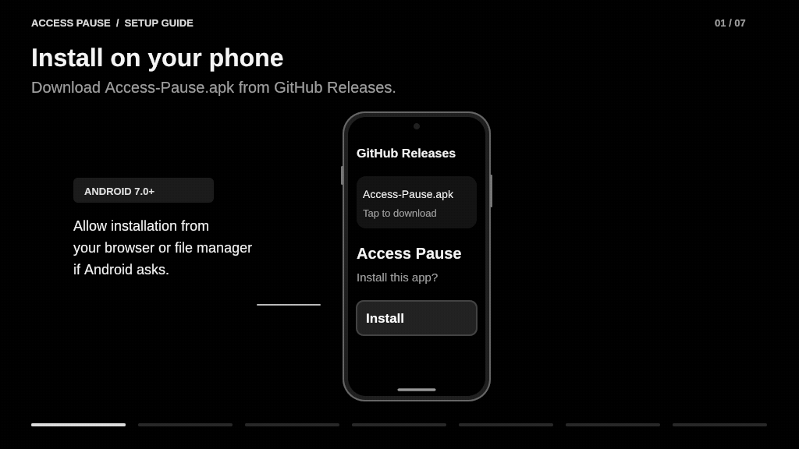

# Pause Accessibility

Save and pause your enabled Android accessibility services with one tap, then restore them when you're done. The app appears on your phone as **Access Pause** and includes a Quick Settings tile that keeps working while those services are off.

## Setup walkthrough



The guide loops through all seven steps. See [One-time setup](#one-time-setup) below for the command you can copy.

## Features

- Saves the enabled app accessibility services before disabling them.
- Restores the saved list and its original accessibility state on the next tap.
- Keeps the saved list across app closure and phone restarts.
- Retains recovery data if Android refuses a change.
- Shows the saved service identifiers for manual recovery in Settings.
- Works offline, with no ads, analytics, overlays, or screen-reading service.

## Install

Download **Access-Pause.apk** from [GitHub Releases](../../releases/latest) and open it on your Android phone. Allow installation from your browser or file manager if Android asks. The APK supports **Android 7.0 and newer**.

A one-time permission grant through a computer is required. Android does not let a regular app switch other apps' accessibility services on and off without this access.

## One-time setup

1. Download [Android SDK Platform Tools](https://developer.android.com/tools/releases/platform-tools) on your computer and extract the archive.
2. Enable **Developer options** and **USB debugging** on your phone.
3. Connect the phone by USB and approve the computer when prompted.
4. Open a terminal in the Platform Tools folder and grant the permission:

```sh
adb shell pm grant app.accesspause android.permission.WRITE_SECURE_SETTINGS
```

In Windows PowerShell, use `./adb.exe` instead of `adb`. On macOS or Linux, use `./adb` if Platform Tools is not on your PATH.

Reopen Access Pause. The app should show that it is ready. You can turn USB debugging off afterward; the computer is not needed for everyday use.

Some manufacturers restrict this permission or require an additional developer setting. If the grant fails, check the error from ADB and your phone's developer settings.

## Use it

1. Swipe down twice to open Quick Settings, choose **Edit**, and add **Access Pause**. Android 13+ also offers an **Add Quick Settings button** in the app.
2. Tap **Pause access** to save your currently enabled services and disable them.
3. Use the app that required accessibility services to be off. Close and reopen that app if it still reports them as enabled.
4. Tap **Restore access** to bring back the saved services.

You can also use **Save & pause services** and **Restore saved services** inside Access Pause. A locked phone must be unlocked before the tile changes settings.

The tile is part of Quick Settings rather than Android's accessibility-service shortcut, so it remains available after accessibility services are disabled.

## Saved services and recovery

Each new pause saves a fresh snapshot. Until restoration succeeds, another tap attempts to restore that snapshot instead of overwriting it. Restore replaces the enabled-service list with the saved list, so avoid changing accessibility service settings while paused.

If Android refuses restoration, open Access Pause and use **Open Android accessibility settings**. The **Saved recovery list** shows which services to enable manually. Services belonging to uninstalled apps cannot be restored until those apps are installed again.

Restore your services before uninstalling Access Pause or clearing its app data. Either action deletes the saved list.

## Compatibility

Access Pause controls **app accessibility services**, including screen readers such as TalkBack. It does not toggle every system accessibility option, such as text size or colour correction, and does not monitor future permission requests.

Make sure you can navigate the touchscreen and Quick Settings without your accessibility services before pausing them. The app does not hide installed services or guarantee that a banking app will accept the device.

## Permissions and privacy

**WRITE_SECURE_SETTINGS** allows the app to read and update the enabled accessibility service list and its enabled flag. The permission is granted through ADB during setup.

The saved list stays in private app storage, with backup disabled. The app has no internet permission, ads, analytics, overlays, or accessibility service of its own.

To remove the permission after restoring your services:

```sh
adb shell pm revoke app.accesspause android.permission.WRITE_SECURE_SETTINGS
```

## Build and test

Requires Java 21 with `keytool`, Android SDK Platform 35, Android Build Tools 35, Eclipse ECJ 3.40.0, Bash, and `zip`. Android 7.0 (API 24) is the minimum; the target is Android 15 (API 35).

Set the paths for your local tools and signing keystore, then run:

```sh
export ANDROID_JAR=/path/to/android-sdk/platforms/android-35/android.jar
export BUILD_TOOLS=/path/to/android-sdk/build-tools/35.0.0
export ECJ_JAR=/path/to/ecj-3.40.0.jar
export SIGNING_KEYSTORE=/path/to/signing.p12
bash build.sh
```

The script runs the save/restore tests, compiles the app, signs `build/Access-Pause.apk`, and verifies its signature. Signing prompts for your keystore password. Keep signing keys and passwords outside the repository. A build signed with a different key cannot update the release APK in place.

Version 1.0.0 passed nine save/restore and recovery test scenarios, APK signature verification, and manifest checks. It has not been tested on a physical Android device; manufacturer-specific behavior still needs verification.

## License

GNU General Public License v3.0. See [LICENSE](LICENSE).
